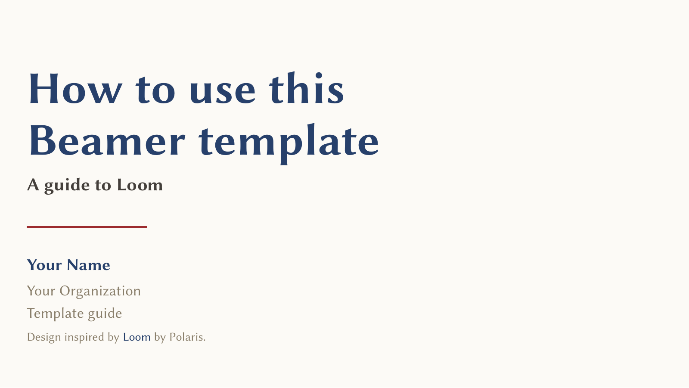
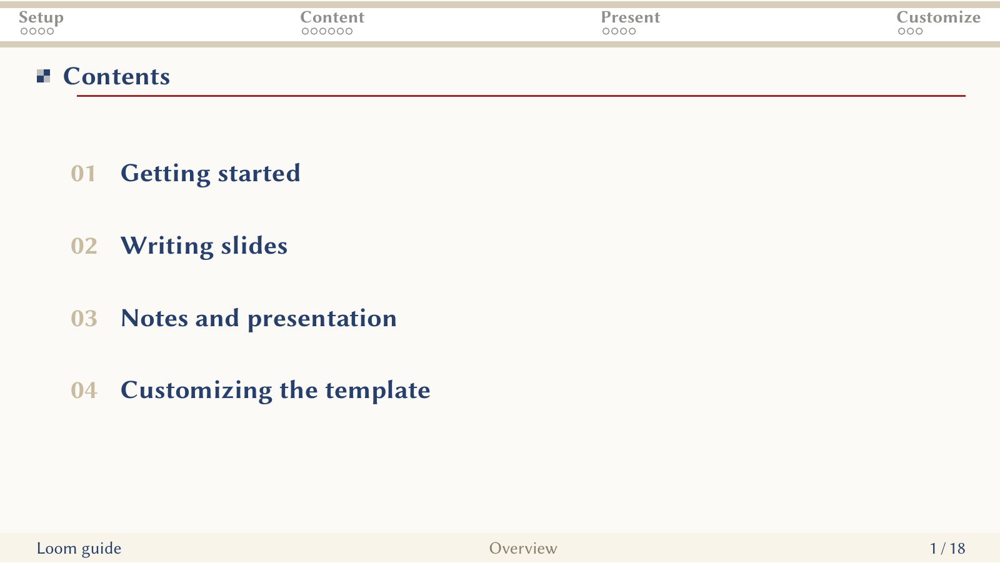
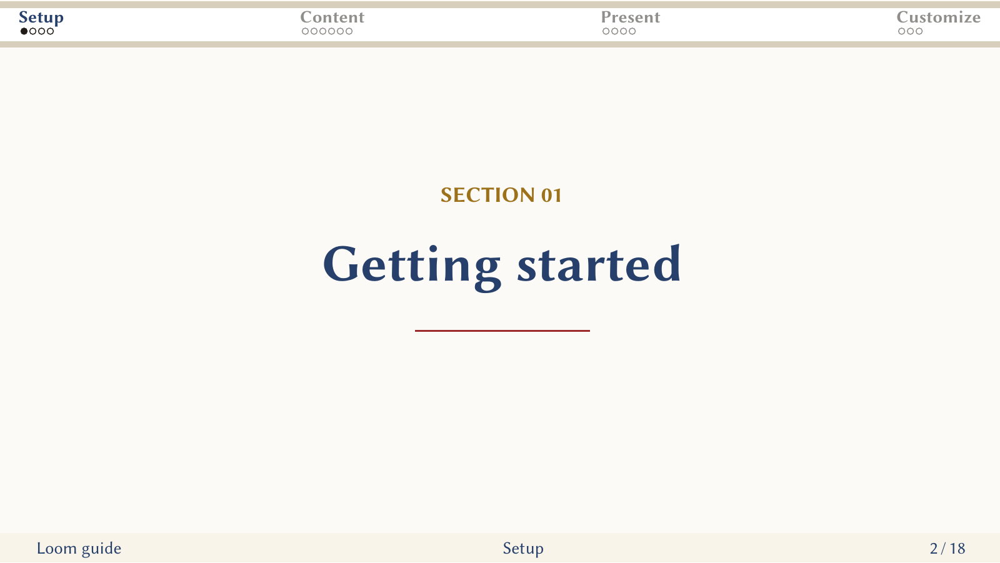
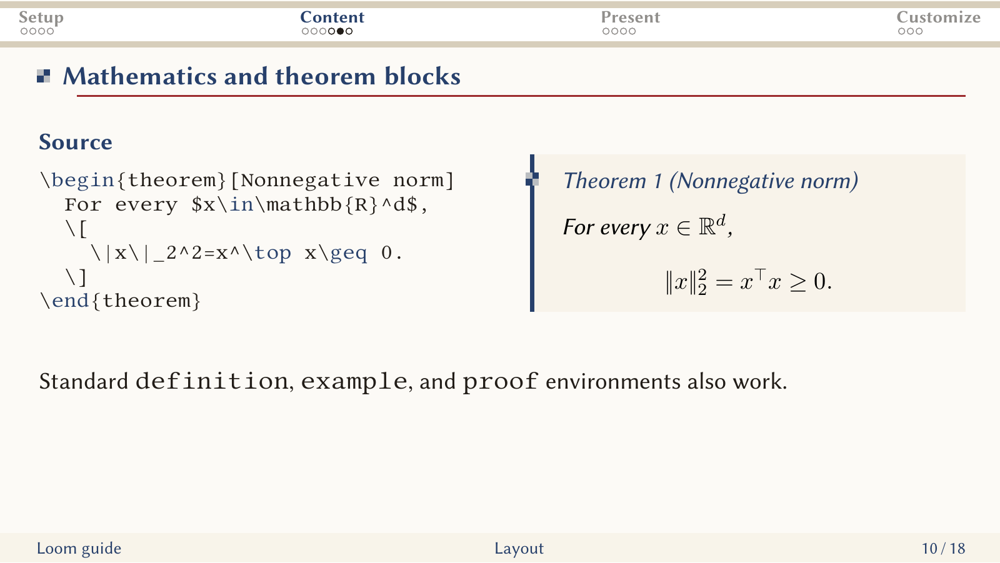
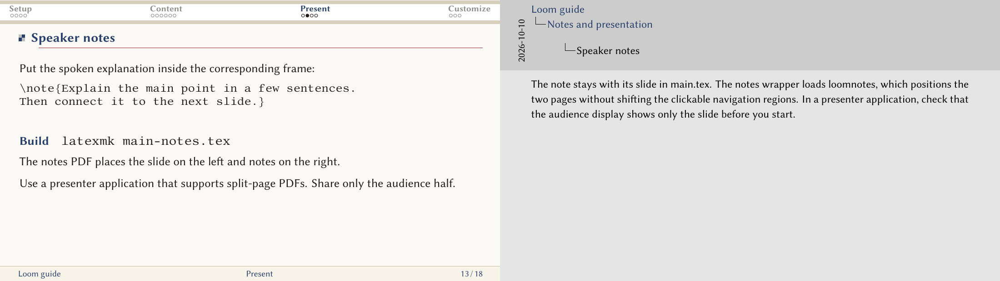

# Loom Beamer Template

A 16:9 Beamer theme for talks, seminars, and reading groups. The theme combines a warm-paper background, an indigo-and-madder palette, mathematical typography, and section-aware navigation.

Design inspired by **[Loom](https://github.com/Polaris-Aeterna/loom-notes)** by **北极甜虾 (Polaris)**. This independent Beamer adaptation reuses Loom's natural-dye palette and woven visual motifs.

The example presentation, **How to use this Beamer template**, is a practical guide to the template itself.

<p align="center">
  <a href="output/pdf/loom-guide.pdf"></a>
</p>
<p align="center">
  
  
</p>
<p align="center">
  
</p>

[Audience PDF](output/pdf/loom-guide.pdf) · [Speaker-notes PDF](output/pdf/loom-guide-notes.pdf) · [Handout PDF](output/pdf/loom-guide-handout.pdf)

## Quick start

Install a current TeX distribution with `latexmk`. XeLaTeX is recommended; the theme uses Libertinus and New Computer Modern when available, with TeX-distribution font fallbacks.

Run these commands **inside this template directory**:

```sh
latexmk main.tex
latexmk main-notes.tex
latexmk main-handout.tex
latexmk starter.tex
```

The included `.latexmkrc` selects XeLaTeX and writes the results to `build/`:

| Source | Result | Purpose |
| --- | --- | --- |
| `main.tex` | `build/main.pdf` | Tutorial with overlays |
| `main-notes.tex` | `build/main-notes.pdf` | Tutorial with notes on the right |
| `main-handout.tex` | `build/main-handout.pdf` | Tutorial with overlays collapsed |
| `starter.tex` | `build/starter.pdf` | Minimal starting point for your own talk |

`latexmk` runs the required passes for navigation, cross-references, and total frame counts. Do not stop after one LaTeX pass if those are still unresolved.

For a new talk, copy `starter.tex` and keep `beamerthemeLoom.sty` in the same directory. Keep `.latexmkrc` for the default build settings and `loomnotes.sty` if you want side-by-side notes.

### Other engines and Overleaf

Use separate build directories when changing engines:

```sh
latexmk -pdf -outdir=build-pdftex main.tex
latexmk -lualatex -outdir=build-luatex main.tex
```

pdfLaTeX uses Latin Modern instead of the Unicode-engine font setup, so line breaks may differ. On Overleaf, upload the template files, choose XeLaTeX, and select `main.tex`, `main-notes.tex`, `main-handout.tex`, or `starter.tex` as the main document.

With XeLaTeX or LuaLaTeX, the text fallbacks are TeX Gyre Pagella, TeX Gyre Heros, and Latin Modern Mono. The math fallback order is XITS Math, then TeX Gyre Termes Math. These fonts come from your TeX distribution, not this repository.

## Customize your talk

```tex
\documentclass[aspectratio=169,11pt,t,compress]{beamer}
\usetheme{Loom}

\title[Short title]{Full presentation title}
\subtitle{Optional subtitle}
\author{Your name}
\institute{Your organization}
\date{\today}
```

The default cover is left-aligned and has **no institutional logo**. For the centered cover, add:

```tex
\setbeamertemplate{title page}[loom centered]
```

To use a logo that you have permission to distribute:

```tex
\setloomlogofile{assets/your-logo.pdf}
```

Section names drive the roadmap and top navigation. Optional short names keep the navigation compact:

```tex
\section[Setup]{Getting started}
\subsection{Your first frame}
```

Select one section-divider style when loading the theme:

```tex
\usetheme{Loom}                   % Minimal, counted dividers (default)
\usetheme[wovensectionpages]{Loom} % Decorative, unnumbered dividers
\usetheme[nosectionpages]{Loom}    % No automatic dividers
```

## Content and overlays

Use ordinary Beamer frames for static content. The theme supports standard `block`, `alertblock`, `exampleblock`, `theorem`, and `definition` environments, plus these helpers:

| Helper | Use |
| --- | --- |
| `loomstrand` | Secondary explanation |
| `loomtakeaway` | Main takeaway |
| `\loomkeyterm`, `\loomriskterm` | Lightweight emphasis |
| `\loomtheoremtag` | Compact result label |
| `\loomsource{...}` | Optional bottom-pinned source note; use once per frame |
| `loomstepblock`, `loomstepalert`, `loomstepexample` | Staged blocks |
| `\loomreveal<...>{...}` | Reveal unboxed content |
| `loomrevealenv`, `loomonlyenv` | Overlay wrappers for custom environments |

For a step-by-step argument:

```tex
\begin{loomstepblock}<+->{First idea}
  Explain the first idea.
\end{loomstepblock}
\begin{loomstepalert}<+->{Qualification}
  State its limitation.
\end{loomstepalert}
```

For everything to appear together, use ordinary `block` environments or unboxed content without overlay specifications. Each reveal creates another PDF page but retains the same frame number. Handout mode collapses overlays; check slides that use replacement content such as `\only` or `overprint`, since these may need explicit `handout:` specifications.

## Speaker notes

Write notes inside each frame:

```tex
\note{Explain the main point, then introduce the next slide.}
```

`main.tex` checks `\loomnotesmode` and loads `loomnotes.sty` only for the notes build. The wrapper `main-notes.tex` turns that switch on before reading the same source, so you do not maintain two decks.

<p align="center">
  <a href="output/pdf/loom-guide-notes.pdf"></a>
</p>

`loomnotes.sty` keeps the slide on the left and notes on the right, including correctly positioned slide-navigation links. Its layout adjustment is specifically for **unscaled right-side notes**; do not combine it with a different `pgfpages` layout. Use the audience PDF on the projector. The notes PDF is intended for a presenter setup that supports a split-page PDF, not as the audience handout.

The notes header retains the talk, section, and frame context. The redundant slide miniature is omitted to avoid duplicate PDF links. To add notes to an automatic section divider, use `\setloomsectionnote{...}` immediately before its `\section` command.

## Repository layout

```text
beamerthemeLoom.sty       Theme, palette, and content helpers
loomnotes.sty             Right-side notes layout
starter.tex               Minimal presentation to adapt
main.tex                  How-to guide and speaker notes
main-notes.tex            Notes-mode wrapper
main-handout.tex          Handout-mode wrapper
.latexmkrc                Default local build settings
.github/workflows/build.yml
assets/                   README preview images
output/pdf/               Published example PDFs
README.md
LICENSE
```

Build files and root-level generated PDFs are ignored; the three example PDFs in `output/pdf/` are intentionally included. A locally retained `osu-logo.pdf`, if present, is excluded from Git and source archives. It is not part of the public template or its license.

The GitHub Actions workflow builds the guide, notes, handout, and starter with XeLaTeX, then checks the audience guide with pdfLaTeX and LuaLaTeX. PDFs are uploaded as workflow artifacts; the workflow does not publish a site or commit generated files. Check its first run after pushing to your own repository.

## Acknowledgments

The original [Loom project](https://github.com/Polaris-Aeterna/loom-notes), created by 北极甜虾 (Polaris), is a XeLaTeX class for fill-in study notes. Its natural-dye palette, woven motifs, and drawing primitives provided the design foundation for this template. Thank you to the original author for sharing that work.

This repository is an independent Beamer adaptation. The presentation layouts, navigation, overlays, and speaker-notes support are maintained here, separately from the original project.

## License

The upstream MIT copyright and permission notice are preserved in [LICENSE](LICENSE), alongside attribution for this Beamer adaptation. Institutional names, logos, and other third-party assets are not licensed by this project.
